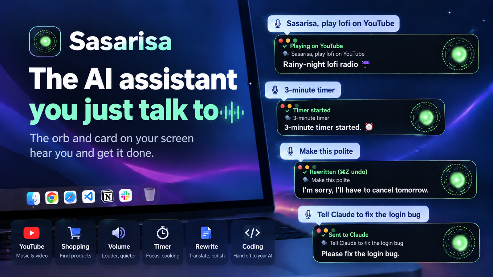
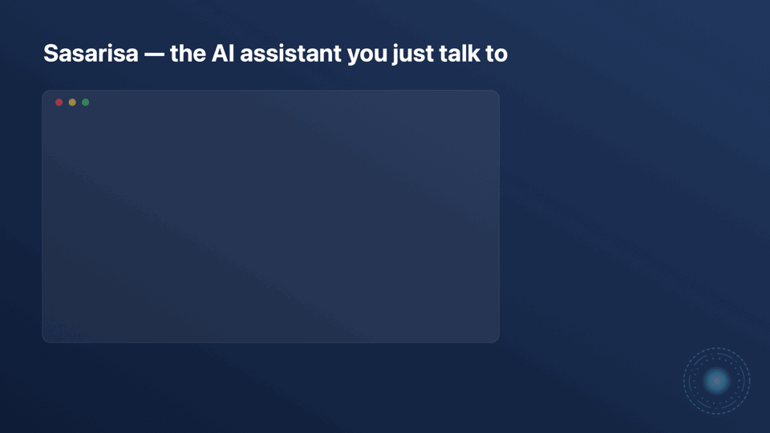

<div align="center">

# ◉ Sasarisa

**The AI assistant you just talk to. Name it, and your Mac does it.** (사사리사 — formerly *Mac Butler*; settings, memory and links carry over)

<p></p>
<br>
<p></p>
<br>

**From “play some lofi” to “fix the login bug” — just say it.**
Small chores happen on your Mac in a second; real coding goes to the AI you use — Claude Code, Codex, Aside, an API key or a free local model. Voice coding, all the way.

**No API key needed — uses the Claude or ChatGPT plan you have** · **Audio never leaves your Mac** · **Asks before deleting, sending or paying**

**[sasarisa.com](https://sasarisa.com/en/)** · [한국어](README.ko.md)

[](../../releases/latest)
[](../../actions/workflows/ci.yml)
[](../../stargazers)
[](#requirements)
[](LICENSE)

```bash
git clone https://github.com/mvcompany8500-web/sasarisa.git && cd sasarisa && ./scripts/install.sh
```

[Install](#install) · [What it can do](#what-it-can-do) · [Privacy & safety](#privacy--safety) · [한국어](README.ko.md) · [Made by turtle buff ai](#made-by)

</div>

## Why

An always-listening voice assistant for macOS, Korean-first with English support. It answers to “Sasarisa” by default — pick any name you like.
Dictation apps like [Handy](https://github.com/cjpais/Handy) turn your voice into text. Sasarisa goes one step further:
it keeps listening for its name, understands what you want, and **does it on your Mac** — without touching the keyboard
and without the mouse pointer jumping around. Anything it can't do on its own goes to Claude Code, which can read the
screen, run commands and use the web.

## What it can do

| You say | It does | Speed |
|---|---|---|
| “Sasarisa” — or the name you pick in setup *(or tap right ⌥)* | chime → listening; keeps listening for 30 s, no name needed | instant |
| **Hold right ⌥ and talk**, release | push-to-talk like Handy — exact audio, runs the moment you let go | ~1 s |
| “I'm home” | greeting screen (flashy, calm or card only) + spoken greeting | instant |
| “Open Chrome” | opens the app | < 1 s |
| “Search for mac mini price” | Google search in your browser | < 1 s |
| “Play lofi music on YouTube” → “play the second one” | plays the first result, then any other result by number | ~1 s |
| “Type hello world” | types into the focused field | instant |
| “Take dictation” … “enter” … “stop” | continuous dictation with Whisper accuracy | ~1 s per sentence |
| “Ask Claude Code to check every project and send me a summary” | opens a **new Claude Code session** in the Claude app and types the task, tidied so Claude understands | ~2 s |
| “3 minute timer”, “What time is it”, “Volume 30”, “Close all windows” | timers, time/date, volume, closes what it opened | instant |
| (select text) “Make this polite”, “Translate this to English”, “Fix the spelling” | rewrites just the selection — never presses send, ⌘Z undoes | ~4 s |
| anything else — “What's on my screen?”, “Summarize this page into Notes” | the AI you picked (Claude Code, Codex, Aside, an API or a local model) works it out and answers out loud | 4–20 s |

Korean has even more built-in shortcuts (several commands in one breath, routines by voice, Naver Map, KakaoTalk replies); in English those go to your AI and still work, just a few seconds slower.

While it's talking — or while the AI is still working — just say the next thing: it stops and takes the new command. “That's all” ends the conversation.

**It grows.** Words your Mac's live recognizer keeps missing (names, product terms) are studied and added to its vocabulary after a few times; stale learned commands and temp files are swept automatically. The menu shows what it has learned.

**It gets faster the more you use it.** When Claude figures out how to do something (“pause the video” → press space), Sasarisa remembers the steps and next time does it instantly, without calling Claude. Say “no” right after and it won't learn it. The menu shows today's Claude calls and tokens.

**Any language.** Korean and English have built-in quick commands; Japanese, Chinese, Spanish, French, German, Portuguese, Italian, Vietnamese, Thai and Indonesian work through Claude, which answers in your language. It picks your Mac's language on first launch.

## How it works

```
mic ──► Apple on-device speech ──► wake word / live text on the HUD
          │ (utterance audio, 16 kHz)
          └──► whisper.cpp large-v3-turbo (local) ──► accurate text
                                                        │
                    quick commands (open, search, YouTube, type, Claude hand-off) ◄─┤
                                                        │
                          claude -p  (one warm Claude Code process, stream-json) ◄──┘
                                │  Bash · jax (Accessibility) · screencapture · WebSearch
                                ▼
                     your Mac  +  spoken answer (built-in macOS voice, or ElevenLabs)
```

* **No mouse movement.** Buttons, links and text fields are found by name through the Accessibility API (`jax`, ~0.1 s) and pressed directly.
* **Warm brain.** One Claude Code process stays open, so a command doesn't pay the 2–4 s start-up cost.
* **Whisper on demand.** The model loads when you call it and unloads after 3 idle minutes (~1 GB).

## Requirements

> **Mac first. Windows comes later** — once wake-word listening and transcription there are as quick as on the Mac.

* macOS 14 (Sonoma) or later — Apple silicon or Intel (Apple silicon recommended; tested on Mac mini M4)
* [Claude Code](https://docs.claude.com/en/docs/claude-code/setup) installed and logged in (`claude` in your terminal once). Uses your Claude plan.
* [Homebrew](https://brew.sh) — the installer adds `whisper-cpp` and `cliclick`
* ~1 GB disk for the Whisper model (optional but strongly recommended for Korean)
* Optional: an [ElevenLabs](https://elevenlabs.io) API key for a nicer voice

## Voice: works out of the box

It talks with **the built-in macOS voice** — free, offline, no sign-up. It picks the most natural one installed for your language
(Korean: Yuna, English: Samantha). Two optional upgrades:

* **Free:** System Settings → Accessibility → Spoken Content → System voice → Manage Voices… → download a **Premium** voice. It's used automatically.
* **Paid:** the voice in the demo video is [ElevenLabs](https://elevenlabs.io). Put your own API key in Settings → Voice. If the key runs out, it falls back to the macOS voice.

## Plug in another brain or voice

The default brain is **Claude Code with your Claude plan**. Settings → Brain lets you pick another one instead — the
hands stay the same tool box with the same safety checks, so no brain gets a shell or your files:

| Brain (`brainProvider`) | What you need |
|---|---|
| `claude-code` (default) | Claude Code signed in to your Claude plan |
| `anthropic` | an Anthropic API key (default model `claude-sonnet-5-5`, with web search) |
| `openai` · `gemini` · `openrouter` · `groq` | that service's API key and a model name from its list (`brainModel`) |
| `ollama` · `lmstudio` | free and offline — a local model server on this Mac (small models are weaker at Korean tool use) |
| `openai-compatible` | any server that speaks the OpenAI chat API (`brainBaseURL`, https — or http only on this Mac) |

Voices (`tts`): `say` (free macOS voice, default), `elevenlabs`, `openai`, `azure` (natural Korean voices, monthly free
tier) or `http` (your own voice server: it gets `{"text","voice","language"}` and answers with audio). If one fails,
the free macOS voice reads instead.

Keys go into the **macOS Keychain**, never into `config.json`: paste them in Settings, or
`Sasarisa.app/Contents/MacOS/Sasarisa --set-key openai` (reads the key from stdin). To check a brain without the
microphone: `MACBUTLER_HOME=/tmp/mb-test MacButler --ask "what time is it?"`.

## Install

```bash
git clone https://github.com/mvcompany8500-web/sasarisa.git
cd sasarisa
./scripts/install.sh            # deps → Whisper model → build → ~/Applications → start at login
```

Or with Homebrew (signed & notarized by Apple):

```bash
brew install --cask mvcompany8500-web/tap/sasarisa
```

A setup window opens on first launch — it checks every permission live, links each fix, and downloads the Whisper model in-app (SHA-256 verified):


Then look for **◉J** in the menu bar. `./scripts/install.sh --no-model` skips the 874 MB download.

### Permissions

Open the **◉J** menu → *Status*. Each ✗ opens the right System Settings pane.

| Permission | Why | Without it |
|---|---|---|
| Microphone | hear the wake word | nothing works |
| Speech Recognition | on-device live text | nothing works |
| Accessibility | type, press keys and buttons | it can talk but not act |
| Screen Recording | Claude can look at the screen when asked | “what's on my screen?” fails |

> Releases are signed with Developer ID and notarized by Apple. **Building it yourself?** An ad-hoc signed build gets a new
> signature each time and macOS forgets the permissions — set `SIGN_ID` to a fixed certificate in `local.env` to keep them.

## Configuration

Menu bar → **Settings…** (⌘,) covers the common options — language, what it calls you, assistant name, wake words, voice, hotkey, Claude model:


Everything lives in `~/.macbutler/`:

| File | |
|---|---|
| `config.json` | all settings (below); restart from the menu after editing |
| `prompt.md` | optional — replaces the built-in personality/rules ([ko](Resources/prompts/prompt.ko.md) · [en](Resources/prompts/prompt.en.md)). `{user}`, `{assistant}`, `{screen}` are filled in |
| `voice/greeting.m4a`, `voice/boot.m4a` | optional — your own greeting line and boot sound |
| `logs/butler.log` | what it heard, decided and said |

```jsonc
{
  "language": "ko",                // "ko" or "en"
  "userName": "Tony",               // how it addresses you
  "assistantName": "Sasarisa",
  "wakeWords": ["sasarisa", "hey sasarisa"],
  "greetingText": "Welcome home, {user}.",
  "activation": "voice",           // "voice" = wake word + hotkey · "hold" = only while holding the hotkey
  "inputDevice": "",               // microphone UID ("" = system default) — list them: Sasarisa --devices
  "outputDevice": "",              // speaker UID for the voice and sounds
  "hotkey": "rightOption",         // tap = wake, hold = push-to-talk: rightOption | rightCommand | none
  "customWords": ["Claude", "GitHub"], // names you say often (imported from Handy automatically)
  "tts": "say",                    // "say" = built-in macOS voice (default) · "elevenlabs" · "openai" · "azure" · "http"
  "sayVoice": "",                  // "" = most natural installed voice · or an identifier from Settings → Voice
  "elevenLabs": { "apiKeyFile": "~/.secrets/.env", "voiceId": "…", "model": "eleven_flash_v2_5" },
  "claudeModel": "sonnet",
  "brainProvider": "claude-code",  // or anthropic · openai · gemini · openrouter · groq · ollama · lmstudio · openai-compatible
  "brainModel": "",                // for API brains, e.g. a model name from the provider's list
  "whisperModel": "",              // default ~/.macbutler/models/ggml-large-v3-turbo-q8_0.bin
  "browserApp": "Safari",           // default · "Google Chrome" etc. · "" = your default browser
  "apps": { "editor": "Visual Studio Code" },   // extra spoken app names
  "silenceSec": 1.8, "followUpSec": 30
}
```

## Make images & videos with Higgsfield (credit-saving)

With a [Higgsfield](https://higgsfield.ai) account you can say 「힉스필드로 … 영상 만들어」 / “Higgsfield, make a 5-second video of …”.

**Connect once** (needs Claude Code), then allow it in the browser window that opens:
```
claude mcp add --transport http --scope user higgsfield https://mcp.higgsfield.ai/mcp
```

**Credits are money, so:**
1. **Price first, 0 credits.** It plans the cheapest way and only asks the price (`get_cost`) — “5 s video · seedance mini · 720p, 5 credits. Make it?”
2. **Made only after you say yes** — even in free mode. No answer or “no” = 0 credits.
3. **Cheapest by default:** one output; video 5 s, 720p, a mini model (same 5 s: 22.5 → 5 credits); stills on the cheapest model (~0.25); lip-sync only for the talking part. A model, length or resolution you name is kept.
4. **No re-rolls:** the approved one is made once; a failure is reported, not retried.
5. **Per-job cap:** anything over 50 credits is refused (`hfMaxCredits` in config.json).
6. **Reuse:** “from that picture, make a video” starts from the earlier result instead of a new still.

2, 4 and 5 are enforced by Sasarisa's guard, not left to the AI: an unpriced, unapproved or second generation is blocked before it reaches Higgsfield. Results land in `~/Movies/Sasarisa` / `~/Pictures/Sasarisa` and are shown in Finder (not played).

> Higgsfield's unlimited / free generations apply on its website only — generating through MCP always spends credits.

## Free & Pro

**Sasarisa is free and open source.** Everything that runs on your Mac, your subscription or your own API key is free, and stays free.

- **Free (all of it):** wake word, quick commands, dictation, rewriting, every brain (local: Claude Code, Codex, Ollama, LM Studio, Aside; any API key), sending to the right Claude window, multi-step jobs (search then answer, reply in a messenger), routines, free mode, grow-together learning.
- **Pro (coming):** only what runs on our servers — call it from your phone (your Mac at home does it), sync across Macs (memory, routines, learned phrases), a routine library to share and pick up routines, early features and priority help. Not sold separately: it's part of the [TurtleMaker](https://maker.buffm.com) membership.
- Nothing that is free today will become paid.

## Privacy & safety

* **Stays on your Mac:** microphone audio, wake-word detection, Whisper transcription, logs. No telemetry — the only thing ever shared is opt-in grow-together learning (below).
* **Leaves your Mac:** the text of commands that go to the brain you chose (Claude Code / Anthropic by default) and, if you picked a paid voice, the answers it reads aloud. A local brain (Ollama, LM Studio) keeps everything on the Mac. **GPT via Codex** uses the Codex CLI you're signed in to (your ChatGPT plan, no key) with its shell, file and browser tools off and only Sasarisa's tool box attached. With **Aside** as the brain, those commands go to your Aside app through its CLI (`aside "<task>"`; install it in Aside → Settings → Developer and run `aside login` once) and Aside's own policies apply inside its browser. Quick commands never leave the Mac.
* **Safe by default, whatever the brain.** The brain only gets Sasarisa's tool box — no shell, no file reading or writing, no fetching URLs — and it can't press or type anything in terminals, code editors, the Claude app, System Settings, Keychain, password fields or permission prompts.
* **Asks before anything irreversible.** Send, pay, post and delete buttons — and Enter in messengers or web forms, line breaks typed by the brain — wait for "Shall I send it?" → yes. The one shortcut: you asked for exactly that while holding the hotkey (a TV can say "send", it can't hold the key).
* **Asks before handing work to a Claude Code session.** Anything the brain wants to hand over waits for your spoken yes, so a TV or a web page can't start work on your computer. ("Right away" mode applies only when you ask for Claude yourself.)
* **Free mode (Settings, off by default):** only payments ask; sending, posting, deleting and hand-offs to Claude just happen. TV or video audio can sound like a command, so pair it with headphones or the hotkey.
* **Grow together (chosen on first run, changeable in Settings):** only if you choose it, once a day it shares short sentences it understood and the quick command they ran (volume, video, closing pages, opening apps) with no name. No audio, conversations, screen, files, names or search words. A sentence reaches everyone only when 5+ different installs on 3+ networks use it.
* Everything it pressed, typed or opened is logged in `~/.macbutler/logs/actions.log`.
* Other apps can't send it commands (owner-only control socket). Details and how to report a vulnerability: [SECURITY.md](SECURITY.md).
* Use the menu toggle to stop listening during calls and meetings.

## Known limitations

* Bluetooth headsets switch to low-quality mic mode while it listens — use a USB/built-in mic.
* With speakers (not headphones) you can still cut in — it compares the mic with how loud it is talking — but speak close to the mic; a loud room or very loud speakers make it harder.
* The Claude hand-off relies on the Claude desktop app's sidebar and prompt box labels; a UI update may break it.
* Quick commands are Korean and English only. Everything else depends on Claude.

<details>
<summary><b>Troubleshooting</b></summary>

* **Nothing happens when I say “Sasarisa”** — menu → *Status*: all ✓? Check `~/.macbutler/logs/butler.log` for `heard[...]` lines.
* **It types nothing** — Accessibility is off, or was reset after a rebuild. Remove Sasarisa from the list and add it again.
* **“Claude Code is not installed”** — run `claude` once in Terminal, or set `"claudePath"` in config.json.
* **Slow** — check `uptime` / Activity Monitor; heavy builds or renders slow everything down. Whisper only loads after you call it.
* **Test without a mic** — `~/Applications/Sasarisa.app/Contents/Resources/bin/butler say "open Chrome"`
* **Grammar self-test** — `~/Applications/Sasarisa.app/Contents/MacOS/Sasarisa --selftest`
</details>

## Roadmap

- [ ] Signed & notarized release + Homebrew tap (`brew install --cask sasarisa`)
- [x] Settings window (no JSON editing)
- [x] First-run setup window with in-app model download
- [x] Push-to-talk (hold the hotkey)
- [x] Learns what worked and replays it without Claude
- [ ] Quick-command grammars for Japanese, Spanish, …
- [ ] Custom wake-word engine (no Apple speech needed for the wake word)
- [ ] Plug-in commands: drop a small script in `~/.macbutler/commands/`

Have an idea? [Open an issue](../../issues/new/choose).

## Development

```bash
./build.sh                                  # → build/Sasarisa.app (no Xcode project needed)
build/Sasarisa.app/Contents/MacOS/Sasarisa --selftest
./scripts/uninstall.sh [--all]
```

`Sources/MacButler/` — `Ear` (mic + Apple speech), `Whisper`, `Brain` (Claude Code), `Commands` (quick-command grammar),
`Butler` (state machine), `Hands` (keyboard + Accessibility), `HUD`, `BootScene`, `Mouth` (TTS). `Tools/` — `jax`, `butler`, `jclick`, `jtype`.

Issues and pull requests are welcome — see [CONTRIBUTING.md](CONTRIBUTING.md). Quick-command grammars for more languages are especially wanted.

## Credits

[whisper.cpp](https://github.com/ggml-org/whisper.cpp) · [Claude Code](https://docs.claude.com/en/docs/claude-code) · [cliclick](https://github.com/BlueM/cliclick) ·
inspired by [Handy](https://github.com/cjpais/Handy).

*Sasarisa is an independent open-source project. It is not affiliated with, endorsed by or sponsored by Marvel, Disney or Anthropic. “Claude” is a trademark of Anthropic.*

---

## 한국어

한국어 설명은 **[README.ko.md](README.ko.md)** 에 있습니다 · 소개 페이지 [sasarisa.com](https://sasarisa.com/)

## Made by

**turtle buff ai** — a Korean channel about working solo with AI.
This project is built and used daily on camera: [YouTube @turtle_buff](https://www.youtube.com/@turtle_buff) · [turtle-buff.com](https://turtle-buff.com)

If it's useful, a ⭐ helps others find it.

AGPL-3.0 © 2026 MV Co., Ltd. (turtle buff ai) — versions up to 0.6.7 were MIT. The name "Sasarisa" and its logo are not part of the license: see [TRADEMARK.md](TRADEMARK.md) and [NOTICE.md](NOTICE.md).
